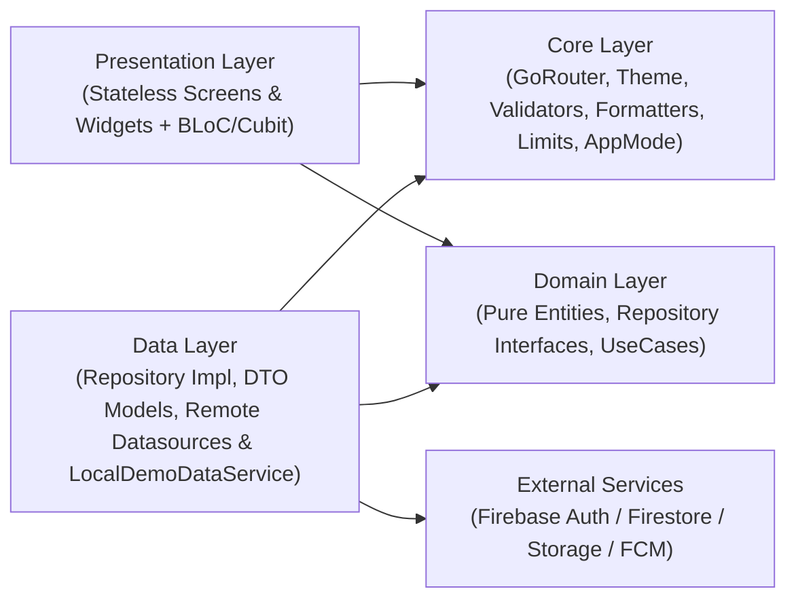
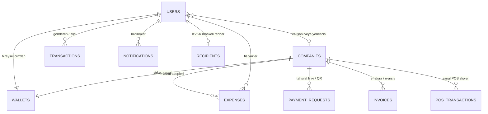

# PayPulse — Yeni Nesil Dijital Cüzdan, Kurumsal Masraf ve B2B/B2C Tahsilat Platformu

> **Çift Yönlü FinTech Ekosistemi:** Bireysel dijital cüzdan, 7/24 FAST para transferi ve akıllı bütçe yönetimini; KOBİ'ler için Sanal POS tahsilatı, GİB e-fatura takibi, OCR destekli personel masraf onayı ve KDV-1 vergi analitiğiyle tek çatı altında birleştiren **Flutter + Firebase + Clean Architecture** uygulamasıdır.

---

## İçindekiler

1. [Projenin Amacı ve Çözdüğü Problem](#-1-projenin-amacı-ve-çözdüğü-problem)
2. [Çift Yönlü Rol Modeli ve Temel İş Kuralları](#-2-çift-yönlü-rol-modeli-ve-temel-iş-kuralları)
3. [Kullanılan Teknolojiler ve Paket Ekosistemi](#-3-kullanılan-teknolojiler-ve-paket-ekosistemi)
4. [Proje Mimarisi (Clean Architecture + BLoC + GoRouter)](#-4-proje-mimarisi-clean-architecture--bloc--gorouter)
5. [Bütüncül Klasör ve Modül Yapısı](#-5-bütüncül-klasör-ve-modül-yapısı)
6. [Veri Modeli, Firestore Şeması ve Güvenlik Kuralları](#-6-veri-modeli-firestore-şeması-ve-güvenlik-kuralları)
7. [Kurulum ve Çalıştırma (Demo & Live Mod)](#-7-kurulum-ve-çalıştırma-demo--live-mod)
8. [Sunum Rehberi (Jüri & Demo Day Akışı)](#-8-sunum-rehberi-jüri--demo-day-akışı)
9. [Test ve Kalite Doğrulama](#-9-test-ve-kalite-doğrulama)
10. [Ekip ve Sorumluluk Dağılımı](#-10-ekip-ve-sorumluluk-dağılımı)

---

## 🎯 1. Projenin Amacı ve Çözdüğü Problem

### Problem
Günlük finansal hayatta bireysel kullanıcılar, saha/ofis çalışanları ve şirket finans yöneticileri parçalı bir araç yığınıyla karşı karşıyadır:
- Bireysel cüzdan, FAST transferi ve bütçe takibi bir uygulamada;
- Çalışanların fiş toplama, KDV ayrıştırma ve masraf avans talepleri kağıt/e-posta süreçlerinde;
- KOBİ'lerin Sanal POS tahsilatları, e-fatura ödemeleri ve muhasebe onay akışları ise ayrı ERP panellerinde yürütülmektedir.

### PayPulse Çözümü
PayPulse, **tek kimlik ve rol tabanlı mimari** üzerinden üç farklı kullanıcı profilini (`b2c`, `employee`, `admin`) kesintisiz bir FinTech deneyiminde birleştirir:
- **Bireysel Cüzdan (B2C):** Çoklu para birimli (`TRY`, `USD`, `EUR`) cüzdan, bakiye gizleme, 4 adımlı FAST transferi, QR ile öde/tahsil et, Luhn/SKT doğrulamalı sanal & metal kart yönetimi ve kategori bazlı bütçe/birikim hedefi takibi.
- **Personel Masraf Akışı (Employee):** Kamera/galeri üzerinden fiş tarama, OCR veri doğrulama (`OcrCameraScannerScreen` → `OcrDataVerificationScreen`), KDV/tutar kontrolü ile yönetici onayına masraf iletme.
- **Yönetici / Üye İşyeri Portalı (Admin B2B):** İşletme kasası ve haftalık nakit akışı (`BusinessSafeOverviewScreen`), taksitli Sanal POS terminali ve komisyon hesabı (`VirtualPosTerminalScreen`), tekli ve toplu Personel Masraf Onay Masası + ERP dekontu, GİB e-fatura listesi ve dinamik KDV-1 Vergi Raporu (`TaxAndVatReportScreen`).

---

## 🎭 2. Çift Yönlü Rol Modeli ve Temel İş Kuralları

### Rol Yetki Matrisi

| Özellik / Modül | Bireysel (`b2c`) | Çalışan (`employee`) | Yönetici (`admin`) |
| :--- | :---: | :---: | :---: |
| Bireysel Cüzdan, FAST Transfer & Kart Yönetimi | ✅ | ✅ | ✅ |
| Dinamik QR Kod Üretme & Okutma / Deep Link Ödeme | ✅ | ✅ | ✅ |
| Bütçe Analitiği & İşlem Geçmişi | ✅ | ✅ | ✅ |
| B2B ↔ B2C Üst Bar Mod Geçişi (`AuthPanelModeToggled`) | ❌ | ✅ | ✅ |
| Şirket Kasa Özeti & OCR Masraf Girişi | ❌ | ✅ | ✅ |
| Masraf Listesi Görüntüleme (Onay/Ret Butonları Kilitli) | ❌ | 👁️ Salt Okunur | ✅ Tam Yetki |
| Sanal POS Tahsilatı & E-Fatura Ödeme | ❌ | ✅ | ✅ |
| Toplu Masraf ERP Dekontu & KDV-1 Vergi Raporları | ❌ (Kalkan 3) | ❌ (Kalkan 4) | ✅ |

### FinTech ve Güvenlik İş Kuralları

1. **Sıfır Kuruş Kaybı (`int` Kuruş Hassasiyeti):** Tüm para, KDV, limit ve işlem tutarları `double` yuvarlama hatalarını önlemek için tamsayı **kuruş (`int`)** olarak saklanır (Örn: `1.500,25 TL` → `150025` kuruş). Biçimlendirme ve ayrıştırma [financial_amount.dart](lib/core/utils/financial_amount.dart) üzerinden yönetilir.
2. **Negatif Bakiye Yasağı ve Atomik Çift Taraflı Transfer:** Kullanıcı veya işletme kasası bakiyesinin 1 kuruş üstüne çıkamaz. Firestore tarafında gönderenden düşme, alıcıya ekleme ve işlem kaydı tek atomik transaction içinde gerçekleştirilir.
3. **Fraud Alarm Kalkanı (`50.000,00 TL` Eşiği):** [app_limits.dart](lib/core/constants/app_limits.dart) içinde tanımlı `AppLimits.fraudLimitInKurus` (`5000000` kuruş) ve üzeri transferler `ExecuteFastTransferUseCase` tarafından ek güvenlik onayı (`fraudConfirmed`) olmadan engellenir.
4. **Sanal POS Komisyon Standardı:** [app_limits.dart](lib/core/constants/app_limits.dart) üzerindeki `AppLimits.posCommissionBps = 139` (`%1,39`) baz puan kuralı ile brüt, komisyon ve net tahsilat `FinancialAmount.posCommission` üzerinden hesaplanır (`1, 3, 6` taksit seçenekleri desteklenir).
5. **İdempotent Masraf Onayı & Gerekçeli Ret:** `ApproveOrRejectExpenseUseCase` aynı masrafın iki kez onaylanmasını/işlenmesini engeller (`status == 'pending' || 'ONAY_BEKLIYOR'`), çalışan rolünün onay vermesini reddeder ve ret işleminde gerekçe metnini zorunlu kılar.
6. **Finansal Doğrulama & Maskeleme:** Kredi kartları **16 hane + Luhn algoritması** (`FinancialValidators.cardNumber`), IBAN'lar **`TR` + 26 karakter + MOD-97 kontrolü** (`FinancialValidators.iban`), son kullanma tarihleri güncel ay/yıl (`FinancialValidators.expiry`) kurallarıyla doğrulanır.
7. **KVKK Veri Minimizasyonu:** Alıcı doğrulamada karşı tarafın tam profili veya bakiyesi paylaşılmaz; `recipients` dizininden yalnızca maskelenmiş ad (`A*** Y*****`) ve IBAN taşınır (`SafeRecipientEntity`).
8. **Değiştirilemez Finansal Defter (Append-Only Ledger):** `transactions` belgeleri oluşturulduktan sonra güncellenemez ve silinemez (`firestore.rules`).

---

## 🛠️ 3. Kullanılan Teknolojiler ve Paket Ekosistemi

Altyapı [pubspec.yaml](pubspec.yaml) ve [analysis_options.yaml](analysis_options.yaml) standartlarına göre yapılandırılmıştır:

| Kategori | Teknoloji / Paket | Sürüm | Projedeki Kullanım Yeri |
| :--- | :--- | :---: | :--- |
| **Framework & Dil** | Flutter SDK & Dart | `3.47.7` / `3.13.5` | Çapraz platform (`macOS`, `Android`, `iOS`, `Web`) UI ve iş mantığı |
| **State Management** | `flutter_bloc` | `^9.1.1` | `AuthBloc` + 22 özelliğe/akışa özel `Cubit` sınıfı (`StatelessWidget` UI disiplini) |
| **Eşitlik Kontrolü** | Dahili `Equatable` | — | Harici bağımlılık olmadan immutable `Entity`/`State` karşılaştırması ([equatable.dart](lib/core/utils/equatable.dart)) |
| **Navigasyon & Deep Link** | `go_router` | `^18.1.3` | `ShellRoute` alt bar, `/pay/:requestId` deep link, 4 kalkanlı RBAC `redirect` |
| **Kimlik Doğrulama** | `firebase_auth` | `^7.0.1` | E-posta/şifre girişi, kayıt ve canlı kullanıcı akışı |
| **Veritabanı** | `cloud_firestore` | `^7.1.0` | Reaktif `snapshots()`, atomik `runTransaction`, koleksiyon indeksleri |
| **Dosya Depolama** | `firebase_storage` | `^14.0.1` | Personel harcama fişi görsellerinin buluta yüklenmesi |
| **Bildirim Altyapısı** | `firebase_messaging` & `flutter_local_notifications` | `^17.0.1` / `^23.0.1` | Android canlı FCM token senkronizasyonu, ön/arka plan push bildirimleri |
| **Telemetri & Kararlılık** | `firebase_analytics` & `firebase_crashlytics` | `^13.0.1` / `^6.0.1` | KVKK uyumlu event kayıtları ve ölümcül hata yakalama ([app_analytics_service.dart](lib/core/analytics_and_crashlytics/app_analytics_service.dart)) |
| **Medya & QR** | `image_picker`, `qr_flutter`, `mobile_scanner` | `^1.2.4` / `^4.1.0` / `^7.5.0` | Fiş fotoğrafı seçimi/çekimi, dinamik QR karekod üretimi ve kamera QR tarama |
| **Tasarım & Formatlama** | `google_fonts`, `intl`, Material 3 | `^9.0.0` / `^0.20.3` | `Plus Jakarta Sans` tipografisi, Açık/Koyu tema (`AppTheme`), `tr_TR` biçimlendirme |
| **Yerel Tercih & Test** | `shared_preferences`, `flutter_lints`, `flutter_test` | `^2.5.6` / `^6.0.0` | Statik analiz, birim/widget testleri |

---

## 🏗️ 4. Proje Mimarisi (Clean Architecture + BLoC + GoRouter)

PayPulse, **bağımlılıkların içe doğru aktığı** sıkı bir Clean Architecture yapısına sahiptir. `presentation` katmanı yalnızca `domain` sözleşmeleri (`I*Repository`, `Entity`, `UseCase`) ve `core` yardımcılarıyla konuşur; `data` modellerine veya Firebase SDK'sına doğrudan bağımlı değildir *(istisna: geliştirici test konsolu `home.dart` / `DevConsoleCubit`)*.

### Katmanlı Bağımlılık ve DI Akışı



### Öne Çıkan Mimari Tasarım Kararları

- **Merkezi Dependency Injection (`lib/main.dart`):** `PayPulseApplication` kökünde `MultiRepositoryProvider` ile 9 domain repository sözleşmesi (`IUserRepository`, `IWalletRepository`, `ITransactionRepository`, `IExpenseRepository`, `ICompanyRepository`, `INotificationRepository`, `IPaymentRequestRepository`, `IBudgetRepository`, `IInvoiceRepository`) bağlanır. `_PayPulseRouterHost` üzerinde `AuthBloc`, `NotificationCubit` ve `AppRouter` başlatılır.
- **Tamamen `StatelessWidget` Ekranlar:** Kullanıcı ekranlarının tamamı (`21` ekran dosyası / `22` public `StatelessWidget` ekran sınıfı) `StatelessWidget` olarak tasarlanmıştır. Tüm ekran durumları, `Timer`'lar, `PageController`'lar ve `TextEditingController`'lar ilgili ekranın `bloc/` altındaki Cubit/BLoC sınıfında yönetilip `close()` içinde temizlenir.
- **Dual Environment (`AppMode`):** [app_mode.dart](lib/core/config/app_mode.dart) çalışma ortamını otomatik algılar:
  - `macOS` / `Web` → **`EnvironmentMode.localDemo`**: Apple Developer sertifikası / Keychain gerekmeden [local_demo_data_service.dart](lib/data/datasources/remote/local_demo_data_service.dart) üzerinden tam reaktif `Stream` simülasyonu ile demo çalışır.
  - `Android` / `iOS` → **`EnvironmentMode.liveFirebase`**: Gerçek Firebase Auth, Cloud Firestore, Firebase Storage ve FCM çalışır.
- **4 Durum Yönetimi (`FourStateView`):** Liste ve veri yükleyen ekranlar `ViewStatus` (`loading`, `empty`, `error`, `success`) durumlarını ortak [four_state_view.dart](lib/presentation/widgets/four_state_view.dart) bileşeniyle standart şekilde yönetir.

### 4 Katmanlı GoRouter RBAC Yönlendirme Kalkanı (`AppRouter`)

[app_router.dart](lib/core/router/app_router.dart) içindeki `_handleRedirect` her rota değişiminde `AuthBloc` durumunu dinler (`GoRouterRefreshStream`):

1. **Kalkan 1 (Oturum Koruması):** Oturumu kapalı kullanıcı yalnızca `/splash`, `/login` ve `/register` rotalarına erişebilir; diğer tüm rotalar (ör. `/home`, `/pay/:requestId`, `/business/*`) `/login` ekranına yönlendirilir.
2. **Kalkan 2 (Auth Yönlendirmesi):** Oturum açıkken `/login` veya `/register` açılmak istenirse `admin` kullanıcılar `/business/overview`, diğer roller `/home` rotasına yönlendirilir.
3. **Kalkan 3 (B2B Erişim Kalkanı):** `b2c` rolündeki bireysel kullanıcılar `/business/*` rotalarının hiçbirine giremez (`!authState.canAccessBusinessPanel` → `/home`).
4. **Kalkan 4 (Yönetici / Admin İzolasyonu):** `employee` rolü işletme genel bakışını ve masraf ekranını görebilse de yalnızca `admin` rolüne açık olan **KDV/Vergi Raporları** (`/business/reports`) ve **Toplu Masraf ERP Dekontu** (`/business/expenses/batch-approval`) rotalarına giremez (`!authState.canApproveExpenses` → `/business/overview`). Ayrıca masraf merkezinde onay/red kontrolleri rol bazlı kilitlenir.

---

## 📁 5. Bütüncül Klasör ve Modül Yapısı

### Kök Dizin

```text
PayPulse/
├── lib/                        # Uygulama kaynak kodları (Clean Architecture)
├── test/                       # Unit, BLoC/Cubit, Repository ve Widget testleri
├── assets/images/              # Marka logoları (paypulse_logo*.png)
├── firestore.rules             # Sunucu tarafı Cloud Firestore güvenlik & atomiklik kuralları
├── firestore.indexes.json      # Bileşik Firestore sorgu indeksleri
├── firebase.json               # Firebase CLI & Emülatör yapılandırması
├── test_security_rules.js      # Firestore Emulator üzerinde güvenlik kurallarını doğrulayan JS suite
├── analysis_options.yaml       # Dart statik analiz ve lint kuralları
└── pubspec.yaml                # Bağımlılıklar ve asset bildirimleri
```

### `lib/` Katmanları ve Klasör Görevleri

```text
lib/
├── main.dart                               # Uygulama girişi, Firebase init (Live mod) ve MultiRepositoryProvider DI kökü
├── firebase_options.dart                   # FlutterFire platform yapılandırma sabitleri
│
├── core/                                   # Tüm katmanların paylaştığı altyapı, sabitler ve yardımcılar
│   ├── analytics_and_crashlytics/          # Firebase Analytics & Crashlytics sarmalayıcısı (PII filtrelenmiş)
│   ├── config/                             # AppMode (macOS/Web -> localDemo, Android/iOS -> liveFirebase)
│   ├── constants/                          # AppLimits (fraud eşiği, QR süre, POS komisyon), AppStrings, FirestoreCollections
│   ├── errors/                             # AppException & Türkçe AuthErrorMessages haritalayıcısı
│   ├── firebase_configuration/             # FirebaseCore başlatıcı (FirebaseConfigure)
│   ├── formatters/                         # EmailInputFormatter, CardNumberInputFormatter, ExpiryDateInputFormatter, TurkishCurrencyInputFormatter
│   ├── router/                             # AppRoutes sabitleri & AppRouter (ShellRoute + 4 RBAC Kalkanı + Deep Link)
│   ├── theme/                              # AppColors (Light/Dark + Hero gradient), AppTextStyles, AppTheme (tema bildirimcisi)
│   ├── utils/                              # Equatable, FinancialAmount (kuruş/yazı/komisyon), IbanGenerator, FirestoreSeeder
│   └── validators/                         # AuthValidator (e-posta/şifre) & FinancialValidators (Luhn, MOD-97 IBAN, SKT, CVV, tutar)
│
├── domain/                                 # Saf Dart iş mantığı katmanı (Flutter/Firebase bağımlılığı YOKTUR)
│   ├── entities/                           # 13 immutable iş nesnesi (11 dosya): User, Wallet, Transaction, Expense, Invoice,
│   │                                       # PosTransaction, Company, Notification, PaymentRequest, SafeRecipient, Budget, BudgetCategory, SavingsGoal
│   ├── repositories/                       # 9 soyut repository sözleşmesi (IUserRepository ... IBudgetRepository)
│   └── use_cases/                          # 6 çekirdek iş kuralı: CalculateVatSummary, SubmitExpense, ApproveOrRejectExpense,
│                                           # ExecuteFastTransfer, ExecutePosPayment, PayPaymentRequest
│
├── data/                                   # Veri erişimi, DTO dönüşümü ve platform kaynakları
│   ├── datasources/remote/                 # FirebaseAuthDatasource, FirebaseFirestoreDatasource, FirebaseNotificationDatasource,
│   │                                       # LocalDemoDataService (reaktif in-memory finansal simülatör)
│   ├── models/                             # Firestore JSON <-> Domain Entity dönüşümü yapan 12 DTO sınıfı
│   └── repositories/                       # I*Repository arayüzlerinin gerçek implementasyonları (toEntity / AppMode uyumlu)
│
└── presentation/                           # Stateless UI ekranları, paylaşılan bileşenler ve BLoC/Cubit durum yönetimi
    ├── shell_navigation/                   # MainShellWrapperScreen: Konuma/role uygun 5'li alt navigasyon barı (B2C & B2B sekmeleri)
    ├── widgets/                            # Ortak UI bileşenleri ve bildirim durumu
    │   ├── bloc/                           # NotificationCubit (okunmamış sayaç ve canlı bildirim akışı)
    │   └── *.dart                          # DarkGradientHeroCard, FourStateView, RoleSwitchAppBar (AuthPanelModeToggled + Demo Switch), WeeklyBarChart,
    │                                       # BudgetDonutChart, CustomNumpadWidget, StatusBadgeWidget, ReceiptSummaryCardWidget, TransactionListTileWidget
    └── screens/                            # Özellik bazlı ekran modülleri (her biri kendi bloc/ klasörüne sahiptir)
        ├── splash_and_onboarding/          # SplashScreen & SplashCubit (animasyonlu açılış ve rota karar verici)
        ├── auth/                           # LoginScreen, RegisterScreen, AuthBloc (Event/State), LoginFormCubit/RegisterFormCubit
        ├── home_wallet_and_safe/           # HomeScreen (B2C cüzdan), BusinessSafeOverviewScreen (B2B kasa) + HomeWalletCubit, BusinessOverviewCubit
        │                                   # home.dart & DevConsoleCubit (/developer-console Firebase Test Tezgahı)
        ├── transfer/                       # 4 adımlı FAST akışı (Recipient -> Amount -> Summary / PayLink -> Receipt) + TransferCubit'ler
        ├── qr_and_ocr/                     # QrPaymentCenterScreen, OcrCameraScannerScreen, OcrDataVerificationScreen, EInvoiceGibListScreen + Cubit'ler
        ├── b2b_operations/                 # VirtualPosTerminalScreen, B2bExpenseApprovalCenterScreen, BulkExpenseErpReceiptScreen + Cubit'ler
        ├── analytics_and_reports/          # TransactionHistoryScreen, BudgetAnalyticsScreen, TaxAndVatReportScreen + Cubit'ler
        └── profile_and_cards/              # ProfileSettingsScreen, CardsManagementScreen + ProfileSettingsCubit, CardsManagementCubit
```

---

## 🗄️ 6. Veri Modeli, Firestore Şeması ve Güvenlik Kuralları

### Varlık İlişki Diyagramı



### Firestore Koleksiyon Özeti (`FirestoreCollections`)

| Koleksiyon | Amaç | Kritik Alanlar |
| :--- | :--- | :--- |
| `users` | Kullanıcı profilleri & rol yetkileri | `uid`, `name`, `email`, `role`, `companyId`, `customerNo`, `verificationLevel`, `iban`, `monthlyLimit`, `spentThisMonth`, `hasB2BAccess` |
| `wallets` | Çoklu para birimli bakiyeler (`wallet_{ownerId}`) | `walletId`, `ownerId`, `balanceTl`, `balanceUsd`, `balanceEur` *(kuruş/cent `int`)*, `iban` |
| `transactions` | Değiştirilemez finansal hareket defteri | `txId`, `senderId`, `receiverId`, `amount`, `currency`, `type`, `targetIban`, `isExpense`, `status`, `relatedId` |
| `expenses` | Personel masraf fişleri ve onay süreci | `expenseId`, `employeeId`, `companyId`, `merchantTitle`, `category`, `amount`, `vatAmount`, `receiptImageUrl`, `status`, `rejectReason`, `accountingCode` |
| `companies` | Tüzel kişi ve yönetici yetki listesi | `companyId`, `name`, `taxNumber`, `corporateIban`, `adminIds` |
| `payment_requests` | QR / Ödeme linki (`/pay/:requestId`) talepleri | `requestId`, `merchantId`, `amount`, `currency`, `status`, `description`, `payerId`, `txId` |
| `invoices` | GİB E-Fatura, E-Arşiv ve E-SMM kayıtları | `invoiceId`, `companyId`, `gibInvoiceNo`, `counterpartyName`, `isIncoming`, `documentType`, `totalAmount`, `vatAmount`, `withholdingRate`, `canPayWithFast` |
| `pos_transactions` | Sanal POS tahsilat ve komisyon slipleri | `posTxId`, `terminalId`, `customerName`, `grossAmount`, `commissionRate`, `commissionAmount`, `netAmount`, `cardMasked` |
| `budget_categories` | Kategori bazlı bütçe & kota hedefleri | `categoryId`, `title`, `spentAmount`, `allocatedAmount`, `percentage`, `colorHex`, `iconName` |
| `savings_goals` | Kişisel birikim hedefleri | `id`, `title`, `targetAmount`, `currentAmount`, `deadline`, `iconName` |
| `notifications` | Uygulama içi gerçek zamanlı bildirimler | `notificationId`, `userId`, `title`, `body`, `type`, `isRead`, `createdAt`, `relatedId` |
| `recipients` | KVKK maskeli IBAN rehberi (`iban` ID) | `iban`, `userId`, `maskedName` |

> **Sunucu Güvenliği (`firestore.rules`):** `wallets` güncellemelerinde negatif bakiye ve yetkisiz alan değişikliği engellenir; `expenses` onayı yalnızca ilgili şirketin `adminIds` listesinde bulunan kullanıcılara açıktır ve `walletChange` + `expenseLink` atomik bütünlüğü kural seviyesinde doğrulanır.

---

## 💻 7. Kurulum ve Çalıştırma (Demo & Live Mod)

### Önkoşullar
- **Flutter SDK:** `3.24+` *(doğrulanmış ortam: Flutter `3.47.7` / Dart `3.13.5`)*
- **macOS Sunumu için:** macOS + Xcode Command Line Tools + CocoaPods
- **Android Canlı Firebase için:** Android SDK / Emülatör + Google Play Services

### Adım Adım Başlatma

```bash
# 1. Depoyu klonlayın
git clone https://github.com/nokaygu/PayPulse.git
cd PayPulse

# 2. Paketleri indirin
flutter pub get

# 3. macOS Masaüstü (Local Demo Modu — APNs/Keychain gerekmeden anında sunum)
flutter run -d macos

# 4. Android Emülatör veya Cihaz (Live Firebase + FCM Modu)
flutter run -d android
```

---

## 🎤 8. Sunum Rehberi (Jüri & Demo Day Akışı)

Sunum yapan kişi aşağıdaki hazır demo rollerini ve senaryo adımlarını takip ederek tüm sistemi **5 dakika içinde** uçtan uca gösterebilir:

### Hazır Demo Kullanıcıları (macOS / Web Demo Modu)

Giriş ekranındaki (`LoginScreen`) hızlı demo kartlarıyla tek tıkla oturum açılabilir veya oturum açıldıktan sonra üst bardaki ([role_switch_app_bar.dart](lib/presentation/widgets/role_switch_app_bar.dart)) rol değiştiriciden geçiş yapılabilir:

| Demo Kartı | Rol | Başlangıç Bakiyesi | Öne Çıkan Akış |
| :--- | :--- | :--- | :--- |
| **Deniz Aksoy** | `b2c` (Bireysel) | `₺12.500,00` (`+ 500 USD`, `300 EUR`) | Çoklu döviz, FAST Transfer, QR, Kartlar, Bütçe |
| **Ahmet Yılmaz** | `employee` (Çalışan) | `₺5.000,00` (Kişisel) | Fiş tarama/OCR gönderme, B2B salt okunur sınır kontrolü |
| **Ali Yılmaz** | `admin` (Yönetici) | `₺10.000,00` Kişisel / `₺245.800,00` Şirket Kasası | Sanal POS, Masraf Onay/Ret, ERP Dekontu, E-Fatura, KDV-1 Raporu |

> **Önerilen 4 Adımlı Canlı Demo Senaryosu:**
> 1. **Açılış & B2C (`Deniz Aksoy`):** Splash geçişini gösterin → Ana sayfada `TRY/USD/EUR` sekme geçişi ve bakiye gizlemeyi gösterin → *Para Gönder* üzerinden **4 adımlı FAST transferini** çalıştırın (isterseniz `50.000 TL` üzeri tutar yazarak **Fraud Kalkanı** uyarısını tetikleyin) → *Profil → Kartlarım* üzerinden Luhn + SKT doğrulamalı yeni sanal kart oluşturun.
> 2. **Çalışan & Yetki Kalkanı (`Ahmet Yılmaz`):** Üst bardan `Ahmet Yılmaz` rolüne geçin → İşletme panelinde **OCR Fiş Tarama** (`ocr-scan` → `ocr-verify`) akışıyla yeni masraf talebi gönderin → **Raporlar** sekmesine dokunduğunuzda GoRouter **Kalkan 4**'ün yetkisiz erişimi otomatik engellediğini gösterin.
> 3. **Yönetici B2B & Finans (`Ali Yılmaz`):** Üst bardan `Ali Yılmaz` rolüne geçin → **Sanal POS** ekranında taksitli kart tahsilatı yapıp komisyon hesaplamasını (`%1,39`) ve slibini gösterin → **Masraflar** merkezinde az önce girilen fişi tek tıkla veya toplu onaylayıp **Toplu ERP Dekontu** üretin → **Raporlar** sekmesinde **KDV-1 Matrah & Ödenecek/Devreden KDV** hesabını ve **GİB E-Fatura** ekranını sergileyin.
> 4. **Geliştirici Test Tezgahı (`/developer-console`):** Canlı Firebase / CRUD doğrulamalarını tek ekranda göstermek için Ana Sayfa üst barındaki geliştirici ikonuna (`Icons.developer_mode_rounded`) tıklayın.

---

## ✅ 9. Test ve Kalite Doğrulama

Projedeki `test/` dizini `core`, `data`, `domain` ve `presentation` katmanlarını kapsayan **14 test dosyasından** oluşur:

| Katman | Test Dosyaları | Kapsam |
| :--- | :--- | :--- |
| **`test/core/`** | `auth_error_messages_test.dart`, `auth_input_formatters_test.dart`, `auth_validator_test.dart`, `currency_and_card_formatters_test.dart`, `financial_validators_test.dart` | Firebase hata çevirisi, e-posta/kart/SKT/tutar formatlayıcılar, Luhn & MOD-97 IBAN, kuruş aritmetiği |
| **`test/domain/`** | `use_cases_test.dart` | 6 çekirdek `UseCase` (KDV-1 özeti, masraf gönderimi, idempotent onay/ret, FAST & fraud eşiği, POS, ödeme linki) |
| **`test/data/`** | `firebase_models_and_iban_test.dart`, `local_demo_data_service_test.dart`, `security_and_financial_rules_test.dart` | DTO serialization, `LocalDemoDataService` simülasyonları, KVKK maskelemesi, para birimi eşlemeleri |
| **`test/presentation/`** | `auth_bloc_demo_login_test.dart`, `cubits_and_repositories_test.dart`, `four_state_view_test.dart`, `router_and_screens_widget_test.dart` | `AuthBloc` RBAC güvenliği, tüm ekran `Cubit`'leri + `ExpenseRepository` mapping, `FourStateView`, `AppRouter` 4 kalkanı, `Stateless` ekran testleri |
| **Kök / Emülatör** | `test/widget_test.dart`, `test_security_rules.js` | Temel widget duman testi ve Firestore Emulator güvenlik kuralları suite'i |

### Doğrulama Komutları

```bash
# Statik kod analizi
flutter analyze --no-pub

# Tüm birim ve widget testleri
flutter test --no-pub

# (Opsiyonel) Firestore Emulator ile güvenlik kuralları testi
node test_security_rules.js
```

*Son doğrulamada (`flutter analyze --no-pub` ve `flutter test --no-pub`) sıfır analiz uyarısı ve 87 testin tamamında `%100` başarı elde edilmiştir.*

---

## 👥 10. Ekip ve Sorumluluk Dağılımı

**SoftITO 4. Dönem Mobil — 3. Grup (6 Kişilik Geliştirme Takımı):**

- **Berat Atmaca** — *Team Lead & Core Architecture*: `core/` altyapısı, `GoRouter` Rol Kalkanları ve `ShellNavigation`.
- **Shahd Mohamed Ragab** — *UI / UX & Design System Lead*: Material 3 tema sistemi (`#0D1F2D` → `#12353C`, `#10B981`), özel grafik widget'ları (`BudgetDonutChart`, `WeeklyBarChart`), Bütçe, Profil ve KDV Raporu arayüzleri.
- **Abdullah Belli** — *Network, API & Firebase Lead*: Firebase Auth, Cloud Firestore atomik işlemleri, Firebase Storage ve Android FCM altyapısı.
- **Betül Zağlı** — *Data Models & DTO Lead*: Domain Entity'ler, JSON/DTO modelleri (`toEntity`/`fromEntity`), `FirestoreCollections`, `FirestoreSeeder`, İşlem Geçmişi ve E-Fatura modülü.
- **Eren Türkmen** — *State Management & Logic Lead*: `AuthBloc`, BLoC/Cubit akışları, `Domain UseCase` bağlantıları ve reaktif stream yönetimi.
- **Hasbiyenur Çoban** — *Feature Screens & QA / Test Lead*: Form doğrulamaları, `FourStateView`, Sanal POS, Masraf Onay, Transfer ekranları ve test altyapısı.
