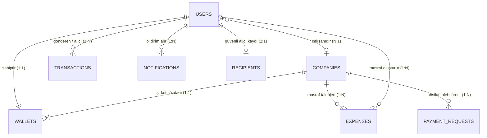

# 🚀 SoftITO 4. Dönem Mobil — 3. Grup Büyük Teslim Projesi

> **Grup Adı:** **3. Grup (6 Kişilik Büyük Teslim Proje Takımı)**  
> **Ekip Üyeleri:** Eren Türkmen, Shahd Mohamed Ragab (Shad), Betül Zağlı, Berat Atmaca, Abdullah Belli, Hasbiyenur Çoban  
> **Proje Başlığı:** **PayPulse — Yeni Nesil Dijital Cüzdan, Masraf Yönetimi ve B2B/B2C Tahsilat Portalı**  
> **Sektörel Alan:** `FinTech, Kurumsal Masraf & Yeni Nesil Ticaret`  
> **Mimari Standart:** Flutter SDK & Clean Architecture + Full Firebase Entegrasyonu  
> **Çift Yönlü Rol Modeli:** Zorunlu (Rol 1: Kullanıcı Portalı vs Rol 2: Yönetici/Sağlayıcı Portalı)  
> **Büyük Teslim & Demo Day:** 13 Kasım 2026 Cuma (Canlı Jüri Sunumu)

---

## 🧭 Hızlı Navigasyon & Bağlantılar
- 📋 **Büyük Teslim Grupları Komuta Paneli:** [[02_PROJELER/egitim/ogrenci_projeleri/6sarli_teslim_projeleri/README|🚀 4 Büyük Teslim Grubu Komuta Merkezi]]
- 👥 **Öğrenci Takip Paneli:** [[02_PROJELER/egitim/ogrenciler|👥 SoftITO Öğrenci Listesi]]
- 🎓 **22 Bireysel Bitirme Projeleri:** [[02_PROJELER/egitim/ogrenci_projeleri/bireysel_bitirme_projeleri/README|🎓 Bireysel Bitirme Projeleri]]
- ⚡ **Eğitim Master Context:** [[02_PROJELER/egitim/egitim|⚡ Eğitim Master Context]]

---

## 🎯 1. Proje Açıklaması & Kapsamı

### 🌟 Projenin Amacı ve Vizyonu
Bireysel kullanıcılar ve şirket personelleri için çok para birimli dijital cüzdan, 7/24 FAST transferi ve akıllı masraf fişi takibi sunan; KOBİ ve işletmeler için ise sanal POS, anlık tahsilat, personel harcama onay mekanizması ve finansal raporlama sağlayan çift yönlü FinTech ekosistemi.

Bu proje; 6 kişilik bir yazılım mühendisliği ekibinin 1 hafta boyunca tam zamanlı çalışarak uçtan uca, store kalitesinde, kurumsal mimariyle ve çift taraflı rol yönetimiyle geliştireceği büyük ölçekli bir bitirme ürünüdür.

---

### 🎭 Çift Yönlü Rol Modeli (Role-Based Dual Mode)

Uygulama iki farklı kullanıcı tipine hizmet verecek şekilde tasarlanacaktır. Giriş yapan kullanıcının rolüne göre arayüz, yetkiler ve dashboard dinamik olarak değişecektir:

#### 👤 1. Modül: Bireysel Kullanıcı & Şirket Çalışanı Cüzdanı (B2C Portalı)
- **Çoklu Para Birimli Ana Cüzdan:** TL, USD, EUR bakiye kartları, bakiye gizleme (Göz ikonu), son finansal hareketler dökümü.
- **7/24 FAST / Kolay Adres Para Transferi:** Telefon numarası veya IBAN ile diğer kullanıcılara anında bakiye gönderme, işlem açıklaması ve komisyonsuz transfer.
- **Dinamik QR Kod ile Öde & Tahsil Et:** Kasa önünde kasaya gösterilecek geri sayımlı QR kod üretimi veya arkadaştan para isteme QR'ı.
- **Şirket Masraf & Fiş Yönetimi Masası:** Şirket adına yapılan harcamanın (Yemek, Taksi, Otel, Yakıt) fiş fotoğrafını çekip Storage'a yükleme, KDV/Tutar girişi ve yöneticiye masraf onay talebi iletme.
- **Kategorize Bütçe & Harcama Grafikleri:** Ay içindeki harcamaların sektör bazlı pasta grafik dökümü ve limit aşım alarmları.

#### 🏢 2. Modül: KOBİ / Üye İşyeri & Şirket Finans Yöneticisi Portalı (B2B Paneli)
- **İşletme Kasası & Sanal POS Terminali:** Kasadan müşteriden kredi kartı veya PayPulse QR ile ödeme alma, başarılı işlem slip simülatörü.
- **Personel Masraf Onay Masası:** Şirket çalışanlarının yüklediği fişleri, KDV tutarlarını ve fatura fotoğraflarını inceleme; tek tıkla 'Onayla / Reddet (Gerekçeli)' aksiyonu ve muhasebe kodu atama.
- **Gün Sonu Kapanışı (Z-Raporu) & Ciro Raporu:** Günlük, haftalık, aylık net tahsilat, iade edilen işlemler ve komisyon kesintisi analitiği.
- **Dinamik Fatura & Ödeme Linki Üretme:** Müşteriye SMS/WhatsApp ile gönderilebilecek ödeme linki simülasyonu.
- **Fraud / Şüpheli İşlem Alarmları (FCM Push):** Kısa sürede yapılan yüksek tutarlı veya olağandışı transferlerde yöneticiye anlık push güvenlik onayı bildirimi.

---

### ⚙️ Temel İş Kuralları & Kritik Mantık Akışları (Business Rules)
6 kişilik ekibin 1 hafta boyunca kodlayacağı kritik iş mantıkları şunlardır:

1. **Atomik Transfer Mimarisi (Firestore Transaction):** A hesabından B hesabına para aktarılırken, A'dan düşme ve B'ye ekleme işlemi tek bir atomik Transaction içinde yapılmalıdır. Bakiye yetersizse işlem kesinlikle hata fırlatmalıdır.
2. **Bakiye Negatife Düşemez:** Kullanıcı hesabında bulunan tutardan 1 kuruş fazla transfer veya harcama yapamaz.
3. **Masraf Yaşam Döngüsü:** Personel fiş yükler -> Durum: `ONAY_BEKLIYOR`. Yönetici onaylarsa -> Durum: `ONAYLANDI` ve onaylanan tutar personelin ana cüzdanına avans/masraf iadesi olarak otomatik yansır. Reddedilirse gerekçe metni personelin bildirim ekranına düşer.
4. **Finansal Maskeleme & Validasyon:** Kredi kartı numarası 16 hane Luhn algoritması, IBAN 'TR' ile başlayan 26 karakter kontrolü ve CVV gizleme standarttır.
5. **Kuruş ve Yuvarlama Hassasiyeti:** Finansal hesaplamalarda kuruş kaybı olmamalıdır; hesaplamalar `intl` NumberFormat ve 2 basamaklı hassasiyetle yönetilir.

---

## 🛠️ 2. İstediğim Teknolojiler & Mimari Standartlar

Projede derste kapsamlı olarak işlediğimiz kurumsal mobil geliştirme teknolojileri ve standartları eksiksiz kullanılacaktır:

- **Mobil Framework & Dil:** Flutter SDK (En güncel kararlı sürüm) & Dart (Strict Type Safety, Null Safety)
- **Mimari Disiplin:** Kurumsal Clean Architecture (`core`, `data`, `domain`, `presentation`) & Katmanlı Klasör Düzeni
- **Kimlik Doğrulama (Auth):** Firebase Authentication (Email/Şifre, opsiyonel Google Sign-In, Rol tabanlı Custom Claims / Profil eşleme)
- **Veritabanı & Canlı Veri:** Cloud Firestore (NoSQL, Realtime Streams, Subcollections, Composite Queries, Atomik Transactions & Batch Writes)
- **Medya & Belge Saklama:** Firebase Storage (Profil fotoğrafları, makbuz/fiş/rapor/ödev dosyaları, ImagePicker, Yükleme Stream'i & İlerleme Barı)
- **Push Bildirimleri & Uyarılar:** Firebase Cloud Messaging (FCM) & `flutter_local_notifications` (Ön plan, arka plan, topic tabanlı toplu duyurular)
- **Hata Takibi & Analitik:** Firebase Crashlytics & Firebase Analytics (Kritik kullanıcı aksiyonları, özel event logları)
- **State Management:** BLoC / Cubit veya Provider / Riverpod (Tek bir kurumsal standart seçilmeli, spagetti setState yasaktır)
- **Navigasyon Mimarisi:** GoRouter (ShellRoute ile kalıcı BottomNavigationBar, Deep Linking, Rol bazlı Route Guards / Yönlendirme Kalkanı)
- **Yerel Depolama (Offline Cache):** SharedPreferences veya Hive / SQLite (Oturum token'ı, çevrimdışı taslaklar, tema tercihleri)
- **Tasarım Sistemi & UI/UX:** Material 3 (ColorScheme.fromSeed, Açık ve Koyu Tema, Akıcı Mikro Animasyonlar, Hero, CustomPainter grafikler)
- **Form & Validasyon Güvencesi:** `Form` & `GlobalKey<FormState>`, Regex validatörleri, InputFormatters, TextEditingController yaşam döngüsü (`dispose`)
- **Kalite & Güvenilirlik:** Sıfır `RenderFlex overflow` (sarı-siyah taşma) kuralı, asenkron `mounted` kontrolleri, Unit & Widget testleri
- **Versiyon Kontrol & Git-Flow:** `main` (Stabil), `develop` (Entegrasyon) ve `feat/<isim>-<modul>` feature branch'leri, PR (Pull Request) onay mekanizması

---

## 📋 3. Ekip Tarafından Tamamlanacak Çalışma Alanı

> [!NOTE]
> Bu bölüm projenin teknik şartnamesi doğrultusunda **6 kişilik öğrenci ekibi tarafından** doldurulmuş; mimari kararlar, ekran tasarımları, DTO modelleri ve GitHub repo ilerlemeleri burada belgelenmiştir.

### 👥 3.1. Takım İçi 6 Kişilik Görev Dağılımı ve Sorumluluk Matrisi

- [x] **[Berat Atmaca] Geliştirici 1 (Team Lead & Core Architecture):** Core katmanı, Base sınıflar, Git branch kuralları, GoRouter Role Guards & Shell Navigation.
- [x] **[Shahd Mohamed Ragab] Geliştirici 2 (UI / UX & Design System Lead):** Material 3 teması, Renk paleti (`#0D1F2D` $\rightarrow$ `#12353C`, `#10B981`), Custom Widgets, Grafikler (`BudgetDonutChart`, `WeeklyBarChart`), Bütçe, Profil ve KDV Raporu ekranları.
- [x] **[Abdullah Belli] Geliştirici 3 (Network, API & Firebase Lead):** Firebase Auth, Firestore servisleri, Storage bağlantısı, FCM altyapısı ve atomik transfer işlemleri.
- [x] **[Betül Zağlı] Geliştirici 4 (Data Models & DTO Lead):** 7 temel Entity ve DTO modelleri (`fromJson`, `toJson`, `copyWith`, `Equatable`), `firestore_collections.dart`, `FirestoreSeeder` servisi, İşlem Geçmişi ve E-Fatura & E-Arşiv ekranları.
- [x] **[Eren Türkmen] Geliştirici 5 (State Management & Logic Lead):** BLoC / Cubit akışları, Event/State sınıfları, Reaktif dinleyiciler.
- [x] **[Hasbiyenur Çoban] Geliştirici 6 (Feature Screens & QA / Test Lead):** Form validasyonları, 4 durum yönetimi (`FourStateView`), POS, Masraf Onay ve Transfer ekranları.

### 📱 3.2. Ekran Listesi ve Kullanıcı Akış Şeması

```text
lib/presentation/
├── widgets/                                  # Tüm ekibin kullandığı ortak widget'lar
│   ├── dark_gradient_hero_card.dart
│   ├── status_badge_widget.dart
│   ├── budget_donut_chart.dart
│   ├── weekly_bar_chart.dart
│   ├── transaction_list_tile_widget.dart
│   ├── custom_numpad_widget.dart
│   ├── receipt_summary_card_widget.dart
│   └── role_switch_app_bar.dart
├── shell_navigation/                         # 5'li BottomNavBar + B2B->B2C Switch
│   └── main_shell_wrapper_screen.dart
└── screens/
    ├── splash_and_onboarding/ (splash_screen.dart)
    ├── auth/ (login_screen.dart, register_screen.dart, bloc/)
    ├── home_wallet_and_safe/ (home_screen.dart — B2C Cüzdan & B2B İşletme Kasası)
    ├── transfer/ (4 Adımlı FAST: recipient, amount, summary, receipt)
    ├── qr_and_ocr/ (qr_payment_center, ocr_camera_scanner, ocr_data_verification, e_invoice_gib_list)
    ├── b2b_operations/ (virtual_pos_terminal, b2b_expense_approval_center, bulk_expense_erp_receipt)
    ├── analytics_and_reports/ (budget_analytics, tax_and_vat_report, transaction_history)
    └── profile_and_cards/ (profile_settings, cards_management)
```

### 🗄️ 3.3. Cloud Firestore Veri Şeması (Koleksiyon & Döküman Tasarımı)

#### 📋 Hızlı Koleksiyon Özeti
- `users`: `{ uid, name, email, role, companyId, customerNo, verificationLevel, iban, monthlyLimit, spentThisMonth, hasB2BAccess }`
- `wallets`: `{ walletId, ownerId, balances: { TRY, USD, EUR }, updatedAt }`
- `transactions`: `{ txId, senderId, receiverId, title, category, amount (kuruş), currency, timestamp, type, targetIban, isExpense, dateGroup, status }`
- `budget_categories`: `{ categoryId, title, spentAmount, allocatedAmount, percentage, colorHex, iconName }`
- `savings_goals`: `{ id, title, targetAmount, currentAmount, deadline, iconName }`
- `expenses`: `{ expenseId, employeeId, employeeName, merchantTitle, category, companyId, amount, vatAmount, receiptImageUrl, status, accountingCode, date }`
- `invoices`: `{ invoiceId, companyId, gibInvoiceNo, counterpartyName, isIncoming, documentType, totalAmount, vatAmount, withholdingRate, badgeText, isPaid, canPayWithFast, issueDate }`
- `pos_transactions`: `{ posTxId, terminalId, customerName, grossAmount, commissionRate, commissionAmount, netAmount, timestamp, cardMasked, status }`

PayPulse NoSQL Cloud Firestore mimarisi; çift yönlü rol yapısını (B2C & B2B), kuruş hassasiyetinde atomik finansal güvenliği ve KVKK veri minimizasyonu prensiplerini destekleyecek şekilde tasarlanmıştır.

#### 📌 3.3.1. Temel Mimari Prensipler
1. **Kuruş Hassasiyeti (Zero Floating-Point Error):** Tüm parasal değerler (`balanceTl`, `amount`, `vatAmount`) ondalıklı (double/float) yerine tamsayı (`int`) kuruş cinsinden saklanır (Örn: `150.50 ₺` ➡️ `15050`).
2. **Değiştirilemez Finansal Kayıt (Append-Only Ledger):** `transactions` koleksiyonundaki belgeler atomik transaction ile oluşturulur; güncelleme (`update`) veya silme (`delete`) Firestore güvenlik kurallarıyla kesinlikle yasaklanmıştır.
3. **KVKK & Veri Minimizasyonu (`recipients` Rehberi):** Para transferi sırasında karşı tarafın bakiye veya e-posta gibi hassas verilerini açığa çıkarmamak için yalnızca maskelenmiş ad ve IBAN tutan genel dizin koleksiyonu kullanılır.
4. **Çapraz Platform Canlı Bildirimler (`notifications`):** FCM push bildirimlerine ek olarak, masaüstü (macOS/Web) ve cihaz içi anlık bildirimler için Firestore `snapshots()` tabanlı reaktif koleksiyon yapısı işletilir.

---

#### 🗺️ 3.3.2. Varlık İlişki Şeması (Entity-Relationship Diagram)



---

#### 📂 3.3.3. Koleksiyon & Belge Detayları

##### 1. `users` (Kullanıcı Profilleri)
* **Döküman ID:** `userId` (Firebase Auth UID)
* **Açıklama:** Kullanıcının temel profilini, rolünü (`b2c`, `employee`, `admin`) ve varsa bağlı olduğu şirketi tutar.

| Alan Adı | Tip | Zorunlu? | Açıklama / Örnek Değer |
| :--- | :--- | :---: | :--- |
| `uid` | `String` | Evet | Firebase Auth benzersiz kullanıcı kimliği (`"usr_12345"`) |
| `name` | `String` | Evet | Kullanıcı tam adı (`"Ahmet Yılmaz"`) |
| `email` | `String` | Evet | Kayıtlı e-posta adresi (`"ahmet@example.com"`) |
| `role` | `String` | Evet | Kullanıcı rolü: `'b2c'` \| `'employee'` \| `'admin'` |
| `companyId` | `String?` | Hayır | Bağlı olunan şirket kimliği (`"comp_softito"`). Yalnızca `employee`/`admin` için doludur. |
| `fcmToken` | `String?` | Hayır | Cihaz push bildirim token'ı (Android FCM) |
| `updatedAt` | `Timestamp?` | Hayır | Son profil güncellenme zamanı |

```json
{
  "uid": "wJ27XkL998Z",
  "name": "Ahmet Yılmaz",
  "email": "ahmet.yilmaz@softito.com",
  "role": "employee",
  "companyId": "comp_tech_as",
  "fcmToken": "fcm_token_device_abc123"
}
```

---

##### 2. `wallets` (Bireysel ve Kurumsal Cüzdanlar)
* **Döküman ID:** `wallet_{userId}` veya `wallet_{companyId}`
* **Açıklama:** Kullanıcıların ve üye işyerlerinin çoklu para birimi bakiyelerini kuruş cinsinden tutar.

| Alan Adı | Tip | Zorunlu? | Açıklama / Örnek Değer |
| :--- | :--- | :---: | :--- |
| `walletId` | `String` | Evet | Cüzdan ID (`"wallet_wJ27XkL998Z"`) |
| `ownerId` | `String` | Evet | Cüzdan sahibi: `userId` veya `companyId` |
| `balanceTl` | `int` | Evet | TL Bakiyesi (Kuruş cinsinden, örn: `150000` = 1.500,00 ₺) |
| `balanceUsd` | `int` | Evet | USD Bakiyesi (Cent cinsinden, örn: `25000` = 250.00 $) |
| `balanceEur` | `int` | Evet | EUR Bakiyesi (Cent cinsinden, örn: `10000` = 100.00 €) |
| `iban` | `String?` | Hayır | Cüzdana tanımlı sanal IBAN (`"TR330006100511123456789012"`) |
| `lastTxId` | `String?` | Hayır | Bakiye güncelleyen son işlem referansı |

```json
{
  "walletId": "wallet_wJ27XkL998Z",
  "ownerId": "wJ27XkL998Z",
  "balanceTl": 245000,
  "balanceUsd": 12050,
  "balanceEur": 5000,
  "iban": "TR330006100511123456789012"
}
```

---

##### 3. `recipients` (Güvenli Alıcı Dizini - KVKK Kalkanı)
* **Döküman ID:** `iban` (Standart IBAN formatı, boşluksuz)
* **Açıklama:** Para transferi ekranında karşı tarafın kullanıcı veya cüzdan dökümanı ifşa edilmeden teyit amaçlı maskelenmiş isim sorgulanmasını sağlar.

| Alan Adı | Tip | Zorunlu? | Açıklama / Örnek Değer |
| :--- | :--- | :---: | :--- |
| `iban` | `String` | Evet | Hedef hesap IBAN numarası (`"TR330006100511123456789012"`) |
| `userId` | `String` | Evet | IBAN sahibinin UID değeri |
| `maskedName` | `String` | Evet | Maskelenmiş isim ve soyisim (`"A*** Y*****"`) |

```json
{
  "iban": "TR330006100511123456789012",
  "userId": "wJ27XkL998Z",
  "maskedName": "A*** Y*****"
}
```

---

##### 4. `transactions` (İşlem Geçmişi & Finansal Hareket Defteri)
* **Döküman ID:** `txId` (`tx_fast_{timestamp}_{random}` veya `tx_pos_{timestamp}`)
* **Açıklama:** Gerçekleşen tüm bakiye transferlerinin, QR/POS tahsilatlarının ve avans iadelerinin silinemez audit trail defteridir.

| Alan Adı | Tip | Zorunlu? | Açıklama / Örnek Değer |
| :--- | :--- | :---: | :--- |
| `txId` | `String` | Evet | Benzersiz işlem takip numarası |
| `senderId` | `String` | Evet | Gönderen tarafın `userId` veya `companyId`'si |
| `receiverId` | `String` | Evet | Alıcı tarafın `userId` veya `companyId`'si |
| `amount` | `int` | Evet | Transfer tutarı (Kuruş cinsinden, örn: `35000` = 350.00 ₺) |
| `currency` | `String` | Evet | Para birimi: `'TRY'` \| `'USD'` \| `'EUR'` |
| `timestamp` | `String / Timestamp`| Evet | İşlemin yapıldığı an (ISO-8601 string veya Firestore Timestamp) |
| `type` | `String` | Evet | İşlem türü: `'fast'`, `'pos_payment'`, `'payment_link'`, `'wallet_deposit'`, `'expense_reimbursement'` |
| `targetIban` | `String?` | Hayır | Transfer hedef IBAN bilgisi |

```json
{
  "txId": "tx_fast_1731435600000_482",
  "senderId": "wJ27XkL998Z",
  "receiverId": "comp_tech_as",
  "amount": 45000,
  "currency": "TRY",
  "timestamp": "2026-11-12T18:20:00.000Z",
  "type": "fast",
  "targetIban": "TR120006100511987654321098"
}
```

---

##### 5. `expenses` (Şirket Personel Masraf & Fiş Yönetimi)
* **Döküman ID:** `expenseId` (`exp_{timestamp}_{random}`)
* **Açıklama:** Çalışanların yüklediği harcama fişlerinin, KDV tutarlarının ve yönetici onay/red yaşam döngüsünün yönetildiği koleksiyon.

| Alan Adı | Tip | Zorunlu? | Açıklama / Örnek Değer |
| :--- | :--- | :---: | :--- |
| `expenseId` | `String` | Evet | Benzersiz masraf fiş kimliği |
| `employeeId`| `String` | Evet | Masrafı giren personelin UID'si |
| `companyId` | `String` | Evet | Personelin bağlı olduğu şirket kimliği |
| `amount` | `int` | Evet | Toplam masraf tutarı (Kuruş cinsinden) |
| `vatAmount` | `int` | Evet | KDV tutarı (Kuruş cinsinden) |
| `receiptImageUrl`| `String` | Evet | Firebase Storage'daki makbuz/fiş görsel URL'i |
| `status` | `String` | Evet | Masraf durumu: `'pending'` \| `'approved'` \| `'rejected'` |
| `rejectReason` | `String?` | Hayır | Yönetici reddetmişse açıklama metni |

```json
{
  "expenseId": "exp_1731439200000_12",
  "employeeId": "wJ27XkL998Z",
  "companyId": "comp_tech_as",
  "amount": 75000,
  "vatAmount": 15000,
  "receiptImageUrl": "https://firebasestorage.googleapis.com/.../receipt_789.jpg",
  "status": "pending",
  "rejectReason": null
}
```

---

##### 6. `companies` (KOBİ / Üye İşyeri Kurumsal Bilgileri)
* **Döküman ID:** `companyId` (Örn: `comp_tech_as`)
* **Açıklama:** B2B modülü kapsamındaki tüzel kişilikler, vergi no, şirket IBAN'ı ve yönetim yetkisine sahip kullanıcı listesi.

| Alan Adı | Tip | Zorunlu? | Açıklama / Örnek Değer |
| :--- | :--- | :---: | :--- |
| `companyId` | `String` | Evet | Şirket kimliği (`"comp_tech_as"`) |
| `name` | `String` | Evet | Şirket ticari unvanı (`"Tech A.Ş."`) |
| `taxNumber` | `String` | Evet | 10 haneli Vergi Kimlik Numarası (`"1234567890"`) |
| `corporateIban` | `String` | Evet | Şirket ana ticari IBAN'ı |
| `adminIds` | `List<String>` | Evet | Şirket adına onay ve yönetim yetkisi olan UID listesi |

```json
{
  "companyId": "comp_tech_as",
  "name": "SoftITO FinTech Çözümleri A.Ş.",
  "taxNumber": "9876543210",
  "corporateIban": "TR550006100511888888888888",
  "adminIds": ["admin_uid_001", "admin_uid_002"]
}
```

---

##### 7. `payment_requests` (Dinamik Tahsilat & Ödeme Linkleri / QR)
* **Döküman ID:** `requestId` (`payreq_{timestamp}_{random}`)
* **Açıklama:** Üye işyerinin sanal POS veya link ile tahsilat için ürettiği dinamik ödeme talepleri.

| Alan Adı | Tip | Zorunlu? | Açıklama / Örnek Değer |
| :--- | :--- | :---: | :--- |
| `requestId` | `String` | Evet | Benzersiz ödeme talep kimliği |
| `merchantId`| `String` | Evet | Tahsilatı talep eden işletme (`companyId`) |
| `amount` | `int` | Evet | Talep edilen tahsilat tutarı (Kuruş cinsinden) |
| `currency` | `String` | Evet | Para birimi (`'TRY'`) |
| `status` | `String` | Evet | Talep durumu: `'pending'` \| `'completed'` \| `'cancelled'` |
| `description`| `String` | Evet | Hizmet / ürün açıklaması (`"Yazılım Danışmanlık Bedeli"`) |
| `payerId` | `String?` | Hayır | Ödemeyi tamamlayan kullanıcının UID'si |
| `completedAt`| `Timestamp?` | Hayır | Ödemenin tamamlandığı zaman damgası |

```json
{
  "requestId": "payreq_1731442800000_99",
  "merchantId": "comp_tech_as",
  "amount": 120000,
  "currency": "TRY",
  "status": "pending",
  "description": "Kasım Ayı Sunucu Lisans Bedeli"
}
```

---

##### 8. `notifications` (Uygulama İçi Canlı Bildirimler)
* **Döküman ID:** `notificationId` (`notif_{type}_{relatedId}_{userId}`)
* **Açıklama:** Çapraz platform uyumlu (macOS, iOS, Android, Web) gerçek zamanlı kullanıcı bildirimleri.

| Alan Adı | Tip | Zorunlu? | Açıklama / Örnek Değer |
| :--- | :--- | :---: | :--- |
| `notificationId` | `String` | Evet | Deterministik bildirim kimliği (Mükerrer bildirimi önler) |
| `userId` | `String` | Evet | Bildirimin muhatabı olan kullanıcının UID'si |
| `title` | `String` | Evet | Bildirim başlığı (`"Para Transferi Geldi"`) |
| `body` | `String` | Evet | Bildirim gövde metni (`"Ahmet Yılmaz size 450,00 ₺ gönderdi."`) |
| `type` | `String` | Evet | Tür: `'transfer_received'`, `'expense_created'`, `'expense_approved'`, `'expense_rejected'`, `'fraud_alert'`, `'general'` |
| `isRead` | `bool` | Evet | Okundu durumu (Varsayılan: `false`) |
| `createdAt` | `Timestamp` | Evet | Bildirim oluşturulma zamanı |
| `relatedId` | `String?` | Hayır | İlgili `txId`, `expenseId` veya `requestId` referansı |

```json
{
  "notificationId": "notif_transfer_tx123_usr456",
  "userId": "usr456",
  "title": "FAST Transferi Geldi",
  "body": "Ahmet Yılmaz hesabınıza 450,00 ₺ FAST transferi yaptı.",
  "type": "transfer_received",
  "isRead": false,
  "createdAt": "2026-11-12T18:25:00.000Z",
  "relatedId": "tx_fast_1731435600000_482"
}
```

---

##### 9. `test_users` (Entegrasyon & Smoke Test Dökümanları)
* **Döküman ID:** `uid` (Test kullanıcısı UID)
* **Açıklama:** Otomasyon ve birim/entegrasyon testlerinin canlı prod verilerini kirletmeden çalıştığı izole test alanı.

---

#### 🔒 3.3.4. Firestore Güvenlik Kuralları (Security Rules) Özeti
* **Kişisel Veri İzolasyonu:** `users` dökümanları yalnızca belgenin sahibi olan `auth.uid` tarafından okunabilir. Başka kullanıcıların profil veya FCM token bilgileri sorgulanamaz.
* **Bakiye Koruma ve Atomiklik:** Cüzdan bakiyeleri hiçbir koşulda negatife düşemez (`balance >= 0`). Para çıkışı yalnızca cüzdan sahibinin bakiyeyi azaltmasıyla; bakiye artışı ise yalnızca atomik transaction eşliğinde `lastTxId` doğrulamasıyla yapılabilir.
* **Şirket Yetkilendirmesi:** `expenses` onayı ve `payment_requests` oluşturulması yalnızca `companies.adminIds` listesinde kayıtlı yöneticiler tarafından gerçekleştirilebilir. Çalışanlar onaylanmış veya bekleyen masraf tutarını sonradan değiştiremez.
* **Denetim İzi (Audit Trail):** `transactions` koleksiyonuna sadece ekleme yapılabilir (`allow create`); finansal geçmiş üzerinde güncelleme veya silme işlemi kurallarla tamamen engellenmiştir (`allow update, delete: if false`).

### 🔗 3.4. GitHub Repository & Sprint Takip Bilgileri
- **GitHub Repo Linki:** `https://github.com/nokaygu/PayPulse`
- **Sprint 1 (09 - 10 Kasım):** Mimari kurulum, modeller, auth ve temel ekran iskeletleri.
- **Sprint 2 (11 - 12 Kasım):** Çift yönlü rollerin canlı bağlanması, Storage, FCM, 4 durum kalkanı ve testler.
- **Demo Day (13 Kasım):** Canlı emülatör/cihaz sunumu ve jüri değerlendirmesi.

---
*Belge Oluşturuldu: 2026-11-09 — Antigravity E-Mektep & SoftITO Mobil Büyük Teslim Projeleri Sistemi*
